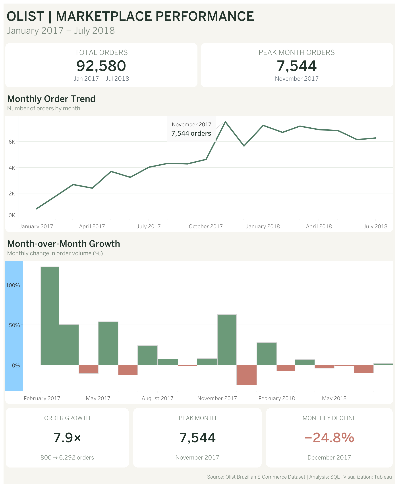

# Olist Brazilian E-Commerce | SQL & Tableau Analysis
E-Commerce Performance Analysis | Data Analytics Portfolio Project

Tools: PostgreSQL · DBeaver · Tableau Public · SQL

Period: January 2017 – July 2018

View Interactive Tableau Dashboard

## Project Overview

This project analyzes order activity on Olist, a Brazilian e-commerce marketplace, to understand changes in customer order volume over time.

The analysis focuses on monthly order trends, month-over-month (MoM) growth, peak order activity, and order status distribution.

I used PostgreSQL to explore and aggregate transactional data, validated the results in DBeaver, and built an interactive dashboard in Tableau Public to communicate the findings.

## Business Questions

The project aims to answer the following questions:

1. How did monthly order volume change between January 2017 and July 2018?
2. Which month recorded the highest number of orders?
3. When did the largest increases and decreases in order volume occur?
4. What proportion of orders reached the delivered status?

## Dataset

Source: Olist Brazilian E-Commerce Public Dataset

The analysis uses the olist_orders table, which contains order identifiers, purchase timestamps, order statuses, and delivery-related dates.

The selected reporting period covers January 1, 2017, through July 31, 2018.

Orders were counted regardless of their fulfillment status, so the results represent recorded order volume rather than completed sales.

## Key Performance Indicators

Metric	Result
Total Orders	92,580
Peak Month	November 2017
Peak Monthly Orders	7,544
January 2017 Orders	800
July 2018 Orders	6,292
Order Volume Increase	7.9×
December 2017 MoM Growth	−24.8%
Delivered Orders	97.06%

## SQL Analysis

### Monthly Order Trends

Order purchase timestamps were aggregated by calendar month using DATE_TRUNC() and COUNT().

### Month-over-Month Growth

I used the LAG() window function to retrieve the previous month’s order count and calculate the percentage change.

MoM Growth (%) = ((Current Month Orders − Previous Month Orders) / Previous Month Orders) × 100

The calculation uses NULLIF() to prevent division by zero. The first month’s MoM value is null because there is no preceding month within the selected period.

The SQL analysis demonstrates experience with:

* Common Table Expressions (CTEs)
* Window functions
* Date-based aggregation
* Conditional filtering
* Percentage calculations
* Data validation

## Key Findings

### 1. Order Volume Increased Significantly

The marketplace recorded 800 orders in January 2017 and 6,292 in July 2018, representing approximately a 7.9× increase in recorded monthly order volume.

This comparison describes the change between two selected months, not an average monthly growth rate.

### 2. November 2017 Was the Peak Month

November 2017 recorded 7,544 orders, the highest monthly order volume within the analysis period.

### 3. Monthly Performance Was Not Consistent

Despite the overall increase in order volume, the marketplace experienced fluctuations. For example, December 2017 recorded a 24.8% decline compared with November 2017.

### 4. Most Orders Had Delivered Status

Of the 92,580 orders analyzed, 89,860 (97.06%) had a delivered status.

Canceled orders represented approximately 0.54%, while unavailable orders accounted for 0.64%.

These figures describe order status distribution and do not establish whether deliveries arrived on time.

## Tableau Dashboard

The interactive dashboard includes:

* KPI cards for total orders and peak monthly volume
* A line chart showing monthly order trends
* A bar chart visualizing month-over-month growth
* Interactive tooltips with order counts and growth rates
* An annotation identifying the peak month
* Summary cards highlighting the main findings

Explore the Interactive Dashboard

## Data Validation & Limitations

Before finalizing the analysis, I checked monthly totals, order statuses, and date coverage.

Several limitations should be considered:

* January 2017 contains 800 orders across 27 active days, with the earliest recorded order on January 5. This affects the interpretation of the 7.9× endpoint comparison.
* The selected reporting period does not include the full history available in the dataset.
* All order statuses are included, meaning that order volume should not be interpreted as completed transactions or revenue.
* The dataset alone does not establish the causes of monthly fluctuations.
* Delivered status does not necessarily mean that an order arrived on time.

## Future Improvements

Further analysis could investigate delivery delays, customer review scores, geographic performance, revenue, and product categories.

## Conclusion

This project demonstrates an end-to-end analytics workflow, from SQL-based data exploration and metric validation to interactive Tableau visualization.

It highlights the importance of combining technical analysis with clear business interpretation and transparent reporting of data limitations.
